# QuickQr

A Flutter app that generates QR codes from text, URLs, emails or phone numbers, and lets you save and share them.

## Screenshots

| Splash | Home | Input |
|:---:|:---:|:---:|
| 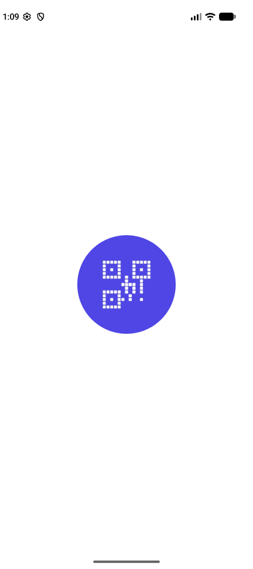 | 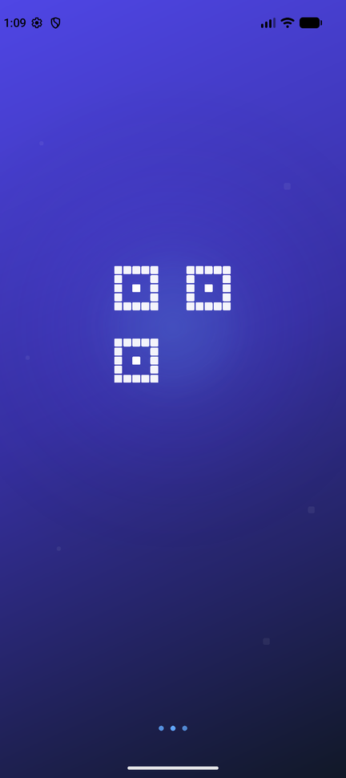 | 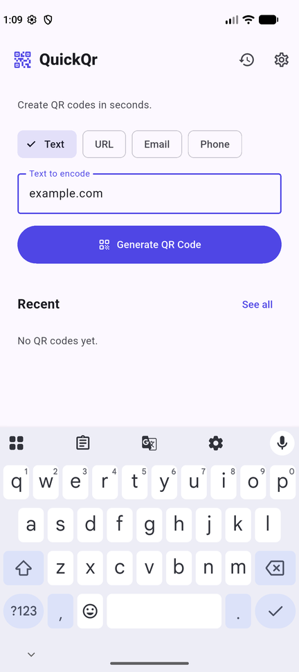 |

| QR result | Save | Share |
|:---:|:---:|:---:|
| 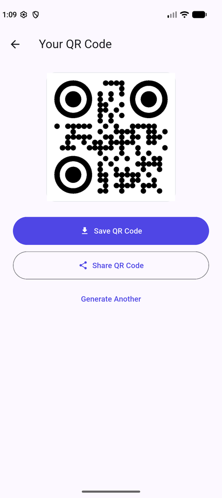 | 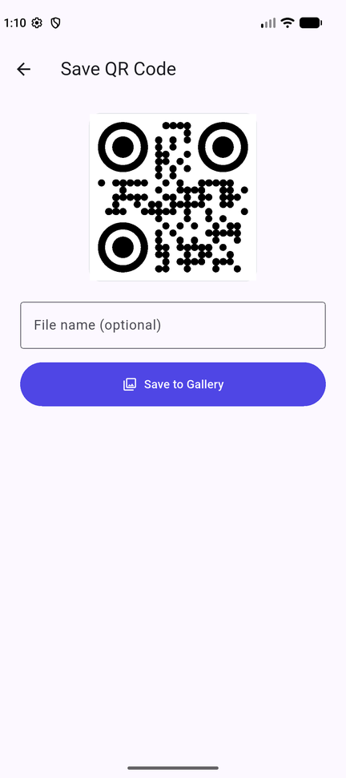 | 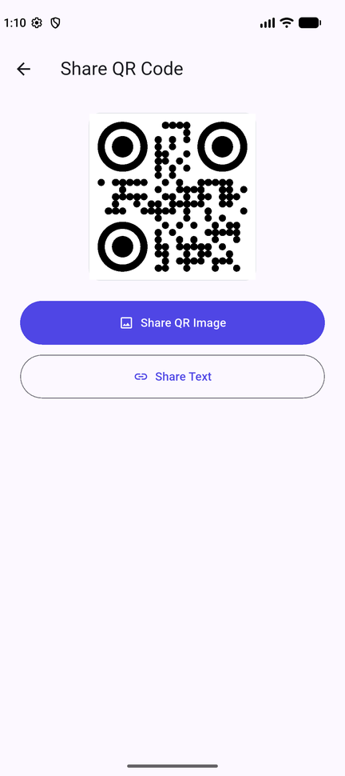 |

| Recent codes | History | Settings |
|:---:|:---:|:---:|
| 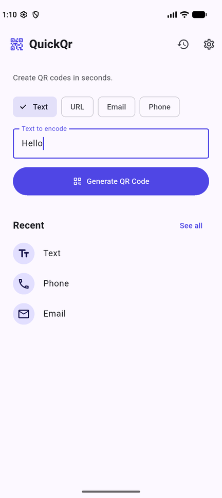 | 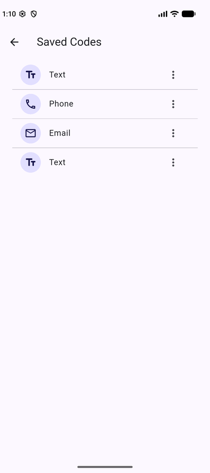 | 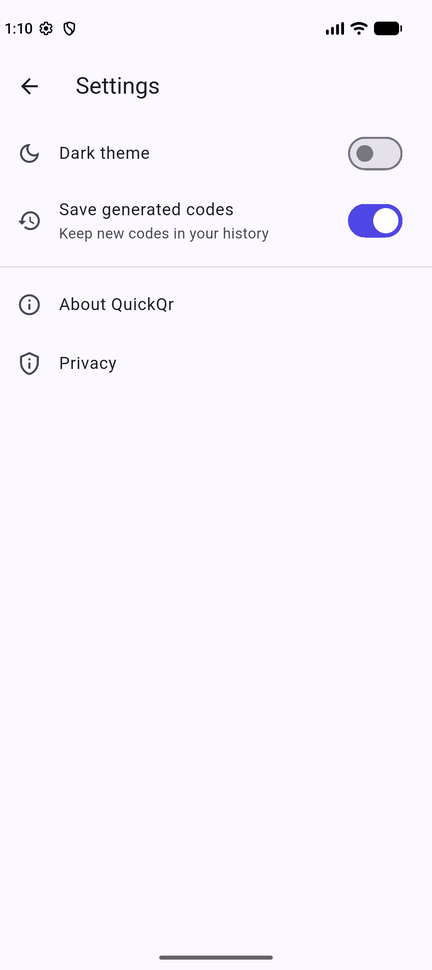 |

| Dark home | Dark history |
|:---:|:---:|
| 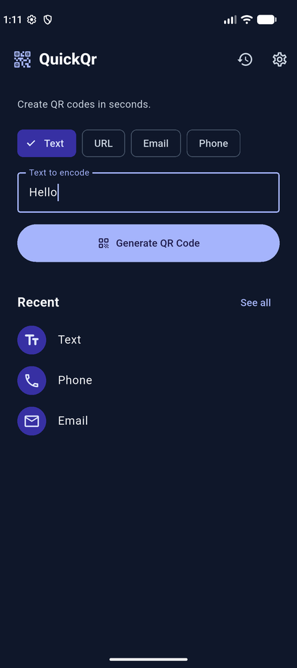 | 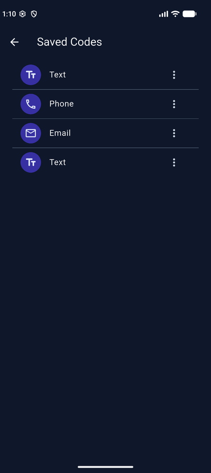 |

## Features

- **QR generation** for Text, URL, Email and Phone, with per-type validation (bare domains get `https://`, emails encode as `mailto:`, phone numbers as `tel:`).
- **Save** the QR as a PNG to the device gallery, with an optional file name.
- **Share** the QR image or its text/URL through the native share sheet.
- **History** of generated codes (open, share, delete), kept between launches.
- **Settings**: light/dark theme, toggle for saving history, About and Privacy.
- **Responsive UI**: content is centered with a maximum width on tablets and fits small and landscape screens.

## Packages

| Purpose | Package |
|---|---|
| QR rendering | `qr_flutter` |
| Gallery saving | `gal` |
| Sharing | `share_plus` |
| Persistence | `shared_preferences` |
| Temp files | `path_provider` |
| App icons (dev) | `flutter_launcher_icons` |

## Project structure

```
lib/
  main.dart            app entry, themes
  models/              QrItem, app settings notifiers
  screens/             splash, home, result, save, share, history, settings
  services/            validators, QR export (PNG/save/share), storage
  widgets/             QR preview, history tile, responsive helpers
  theme/               shared colours
```

## Run

```
flutter pub get
flutter run
```

To regenerate launcher icons after editing `assets/icon/`:

```
dart run flutter_launcher_icons
```

## Test

```
flutter test
```

Saving to the gallery and the share sheet use native plugins, so check them on a real device or emulator (Android or iOS).
